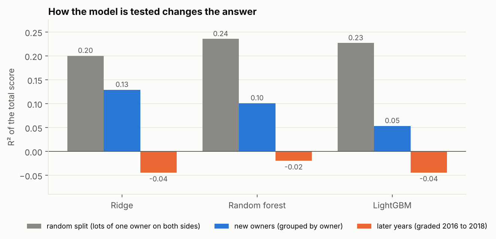
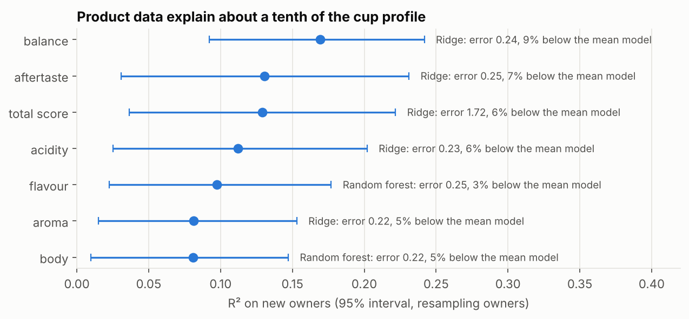
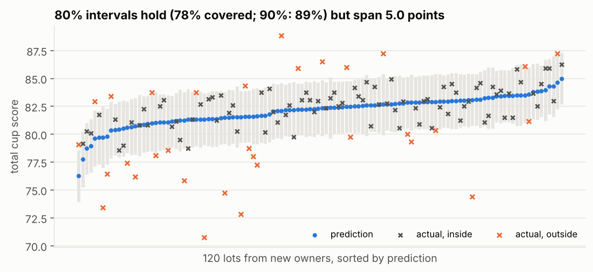
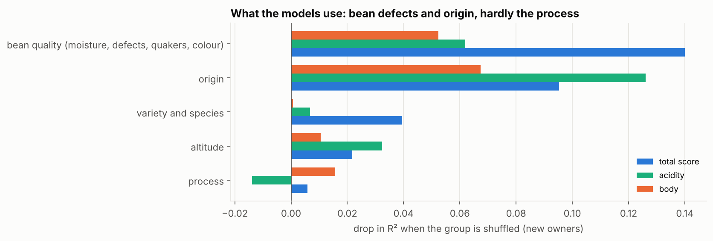
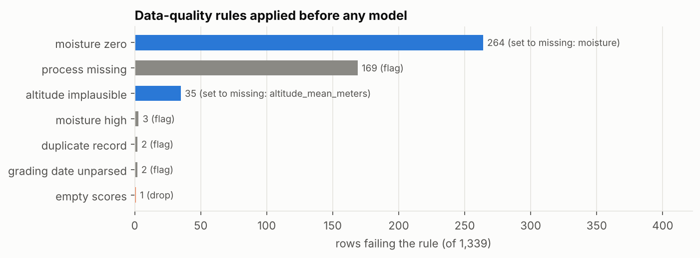
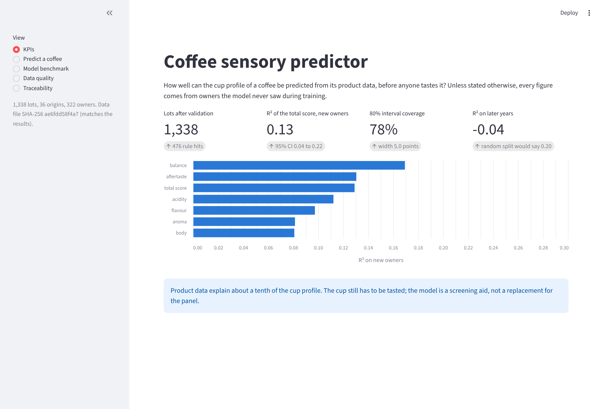

# Coffee sensory predictor

[](https://github.com/Abderrahmane-BOULAMI/coffee-sensory-predictor/actions/workflows/tests.yml)

Can the cup profile of a coffee be predicted from its product data, before anyone tastes it? This project answers with machine learning on 1,338 coffees graded by the Coffee Quality Institute, and puts as much care into the data and the validation as into the models:

- **data-quality rules** run before any model, each with its count and its action, saved with every run;
- **a run manifest** records the data file hash, code version, package versions and settings behind every result, for traceability;
- **three ways of testing** the models (random split, new producers, later years), because they give very different answers;
- **prediction intervals** whose coverage is checked on producers the model never saw;
- **a KPI dashboard** and CSV exports for Power BI;
- **automated tests** run on every change.



## Key findings

1. **Product data explain about a tenth of the cup profile.** From origin, process, variety, altitude, moisture and bean defects, the best model explains 13% of the variance of the total cup score for producers it has never seen (R² 0.13, 95% interval 0.04 to 0.22, resampling producers). Its average error is only 6% lower than always predicting the mean. The attributes behave alike: from 8% (aroma, body) to 17% (balance). The cup has to be tasted: a model on product data can help screen lots, not replace the panel.

2. **How the model is tested changes the answer.** For the total score, the same models reach R² 0.20 to 0.24 on a random split, 0.05 to 0.13 when whole producers are held out, and below zero (-0.02 to -0.04) on lots graded in 2016 to 2018 after training on earlier years. A random split puts lots of the same farm on both sides and flatters the model. On later years every model does about as well as predicting the training average, mostly because the score level shifts between periods.

3. **Adding the harvest year makes the future worse.** With the year as a feature, the ridge model falls from -0.04 to -0.12 on the later years. A future lot always has a year outside the training range, so the year is left out by design.

4. **The intervals are honest, and wide.** Split-conformal intervals built inside the cross-validation cover 78% of new producers' lots at a promised 80% (73% to 85% depending on the fold), and 89% at 90%. But an 80% interval spans 5.0 points on a scale where most lots sit between 80 and 85.

5. **What the models use: bean defects and origin, hardly the process.** Shuffling the bean-quality variables (defects, quakers, moisture, colour) costs the most accuracy on the total score (0.14 of R²), then origin (0.10). Shuffling the process costs almost nothing (0.01).

6. **The data needed fixing first.** 264 lots (20%) have a moisture of exactly 0, a missing value coded as zero; left in, a model would read these lots as bone-dry beans. 35 altitudes are implausible (a value of "1901.64" stored as 190,164 m), one lot has every score at zero, 169 lots have no process, and 2 rows are duplicates.

7. **Who graded the coffee cannot be separated from who grew it.** Within one country, the average score differs by up to 2 points between grading organisations for similar product data. But in 4 of the 13 country and organisation pairs, one producer supplies 90% or more of the lots (all 155 lots of the Guatemalan national association come from a single owner), and adding the grading organisation as a feature does not improve predictions (R² 0.129 without, 0.128 with). The data cannot separate a grading difference from a producer difference. The practical lesson for a sensory team: record who measured, and when.

8. **A model that predicts the total from the ten attributes is circular.** The total is their sum, and such a model reaches R² 0.99995. Any feature measured during the tasting is excluded.

## Results

| | |
|---|---|
|  |  |
|  |  |

Best model per attribute, producers held out (5 folds grouped by owner):

| Attribute | Model | R² (95% interval) | Mean absolute error | Lower than the mean model by |
|---|---|---|---|---|
| Total score | Ridge | 0.13 (0.04 to 0.22) | 1.72 points | 6% |
| Balance | Ridge | 0.17 (0.09 to 0.24) | 0.24 | 9% |
| Aftertaste | Ridge | 0.13 (0.03 to 0.23) | 0.25 | 7% |
| Acidity | Ridge | 0.11 (0.03 to 0.20) | 0.23 | 6% |
| Flavour | Random forest | 0.10 (0.02 to 0.18) | 0.25 | 3% |
| Aroma | Ridge | 0.08 (0.02 to 0.15) | 0.22 | 5% |
| Body | Random forest | 0.08 (0.01 to 0.15) | 0.22 | 5% |

The best model is picked on the same cross-validation, which makes these figures slightly optimistic. For flavour, random forest and ridge are tied (R² 0.097 and 0.094), and ridge has the lower error. The full benchmark (7 targets, 4 models, 3 validation schemes) is in [`results/benchmark.csv`](results/benchmark.csv).

## Method

- **Validation of the data** ([`coffeepred/validate.py`](coffeepred/validate.py)): each rule has a name, a description and an action (drop the row, set a value to missing, or flag it). The report is written to `results/data_quality_report.csv`.
- **Traceability** ([`coffeepred/lineage.py`](coffeepred/lineage.py)): `results/run_manifest.json` holds the SHA-256 of the data file, the git commit and whether the working copy had uncommitted changes (when run inside a git clone), the Python and package versions, the settings and the cleaning steps. The dashboard checks that the data file still matches that hash.
- **Features**: origin, process, variety, species, bean colour, altitude, moisture, category 1 and 2 defects, quakers. Nothing measured during the tasting, and no producer name.
- **Models** ([`coffeepred/models.py`](coffeepred/models.py)): the mean of the training lots (baseline), ridge regression, random forest and LightGBM, each a scikit-learn pipeline with imputation and encoding fitted inside the training folds.
- **Validation**: random 5-fold split; 5 folds grouped by owner (no producer on both sides); training on lots graded before 2016 and testing on 2016 to 2018. Intervals for R² resample whole producers.
- **Intervals**: split conformal inside the grouped cross-validation (75% of the training producers fit the model, 25% calibrate the width).
- **Importance**: drop in R² on the held-out producers when a group of features is shuffled.

See also the [model card](MODEL_CARD.md).

## Run it

```bash
pip install -r requirements.txt
python experiments/run_all.py        # about 2 minutes, writes results/ and powerbi/
python experiments/plot_results.py   # writes results/figures/
pytest -q                            # 8 tests
streamlit run app/dashboard.py       # dashboard
```

The dashboard has five views: KPIs, a form to predict a new coffee with a split-conformal 80% interval, the model benchmark, the data-quality report and the run manifest.



**Power BI.** `powerbi/` holds three tables: every lot with its held-out predictions and its 80% interval around the conformal model's own prediction (`lots_with_predictions.csv`), the model metrics (`model_metrics.csv`) and the data-quality report (`data_quality.csv`). Load them with Get data, Text/CSV.

## Tests

The 8 tests check that the validation finds the known problems (1 empty lot, 35 altitudes, 264 zero moistures) and applies each action, that the manifest hashes the data, that grouped and time splits never leak, that the models find a planted signal and nothing in pure noise, that conformal intervals use the right order statistic and reach their promised coverage, that the bootstrap interval and the importance behave, and that the published results keep their order (random > producers > later years).

## Limitations

- The data come from one certification programme and its graders, between 2010 and 2018. Scores are not consumer liking.
- Owners are used as groups; some farms may sell under several owners.
- The grading-organisation comparison is descriptive: grading, producer and lot selection cannot be separated here.
- The later-years test is not grouped by owner, so some producers appear on both sides.
- The 28 Robusta lots are graded under a different protocol but share the same targets.

## Data

Coffee Quality Institute review pages, collected by James LeDoux ([coffee-quality-database](https://github.com/jldbc/coffee-quality-database)) and republished by [TidyTuesday](https://github.com/rfordatascience/tidytuesday/tree/master/data/2020/2020-07-07) (`data/coffee_ratings.csv`). Producer names are used only to group lots and do not appear in any output.

## Authors

Abderrahmane BOULAMI and Kawtar BELLAMINE, Arts et Métiers ParisTech.
